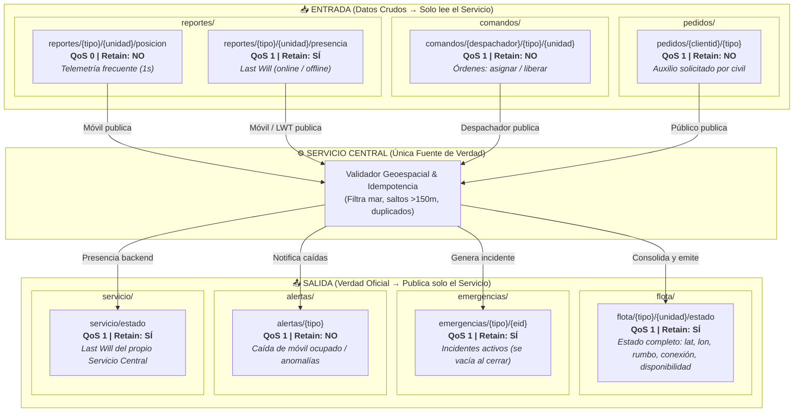

# 🗺️ Plano del Árbol de Tópicos MQTT
> **Sistemas Distribuidos — UNPSJB (Proyecto 2)**  
> *Arquitectura de comunicación desacoplada y eventos mediante Broker EMQX.*

---

## 1. Diagrama Visual del Árbol y Flujo

---

## 2. Matriz Técnica de Tópicos, QoS y Retained

| Categoría | Tópico | Publica | Se Suscribe | QoS | Retained | Justificación de Diseño |
|---|---|---|---|:---:|:---:|---|
| **Entrada** | `reportes/{tipo}/{unidad}/posicion` | Móvil | Servicio (`reportes/+/+/posicion`) | **0** | **NO** | Telemetría rápida (cada 1s). Si se pierde un paquete, en 1s llega uno más fresco. Evita sobrecarga en el broker. |
| **Entrada** | `reportes/{tipo}/{unidad}/presencia` | Móvil + LWT | Servicio (`reportes/+/+/presencia`) | **1** | **SÍ** | Estado de conexión crítico (online/offline). Retained permite al servicio conocer el estado de la flota apenas inicia. |
| **Entrada** | `comandos/{despachador}/{tipo}/{unidad}` | Despachador | Servicio (`comandos/+/+/+`) | **1** | **NO** | Órdenes operativas (asignar/liberar). No se pueden perder en la red. Lleva UUID para idempotencia en el servicio. |
| **Entrada** | `pedidos/{clientid}/{tipo}` | Público | Servicio (`pedidos/+/+`) | **1** | **NO** | Petición ciudadana de emergencia. `{clientid}` primero permite amarrar la regla ACL al dispositivo móvil. |
| **Salida** | `flota/{tipo}/{unidad}/estado` | Servicio | Despachadores (`flota/#`) | **1** | **SÍ** | **La foto oficial.** Consolida coordenadas validadas, disponibilidad y conexión. Retained dibuja la flota al instante al abrir el mapa. |
| **Salida** | `emergencias/{tipo}/{eid}` | Servicio | Despachadores (`emergencias/#`) | **1** | **SÍ** | Lista de emergencias abiertas. Al resolverse, el servicio publica payload vacío para borrar el Retained del broker. |
| **Salida** | `alertas/{tipo}` | Servicio | Despachadores (`alertas/#`) | **1** | **NO** | Eventos inmediatos (ej: se cayó una patrulla en medio de una persecución). Mensaje volátil de aviso. |
| **Salida** | `respuestas/{despachador}` | Servicio | Despachador (`respuestas/{desp-id}`) | **1** | **NO** | Confirmación o rechazo de una orden (ej: comando rechazado porque la ambulancia ya estaba ocupada). |
| **Salida** | `servicio/estado` | Servicio + LWT | Todos | **1** | **SÍ** | Presencia del backend central. Si se cae el contenedor, el broker avisa `offline` y los mapas muestran alerta roja. |

---

## 3. Las Tres Reglas de Oro de la Arquitectura

### 1. La Identidad viaja en el Tópico, NUNCA en el Payload
> **Por qué no mandar `{"id": "amb-01"}` dentro del JSON:**
> En MQTT, el suscriptor (Servicio) no puede saber qué socket TCP mandó el paquete; solo ve el tópico y el payload. Si la identidad estuviera en el JSON, cualquier cliente podría suplantar a otro.
>
> Al poner la identidad en la ruta del tópico (`reportes/ambulancia/${username}/posicion`), la **ACL de EMQX** valida que el usuario autenticado sea el dueño legítimo de esa ruta. Si `amb-01` intenta publicar en la ruta de `pol-03`, el broker lo bloquea antes de que el mensaje llegue al servicio.

### 2. Por qué QoS 0 y 1, pero NUNCA QoS 2
> **Eficiencia y Simplicidad:**
> * **QoS 0:** Ideal para flujos continuos de datos descartables (posiciones GPS cada segundo).
> * **QoS 1:** Garantiza entrega al menos una vez (*at least once*). Para evitar problemas si llega duplicado por reconexión, los mensajes llevan un identificador único (`id` o `ts`), logrando **idempotencia** en el servicio.
> * **Por qué no QoS 2:** Requiere 4 paquetes de sincronización (PUBLISH, PUBREC, PUBREL, PUBCOMP), saturando el broker y la red sin aportar valor real sobre QoS 1 + idempotencia.

### 3. El Poder del Flag Retained
> **Arranque instantáneo (*Late Joiners*):**
> En MQTT común, un cliente solo recibe mensajes publicados *después* de suscribirse. Con `Retained=True`, el broker almacena el último mensaje válido en ese tópico.
> Cuando el operador abre el mapa del despachador, recibe de golpe el último estado retenido de los 15 móviles y de todas las emergencias activas, dibujando la ciudad completa en 100 milisegundos.
