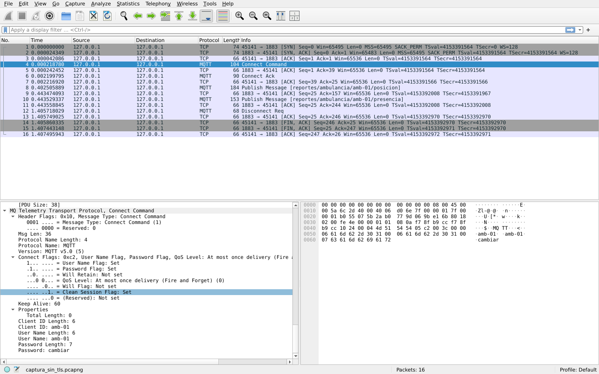
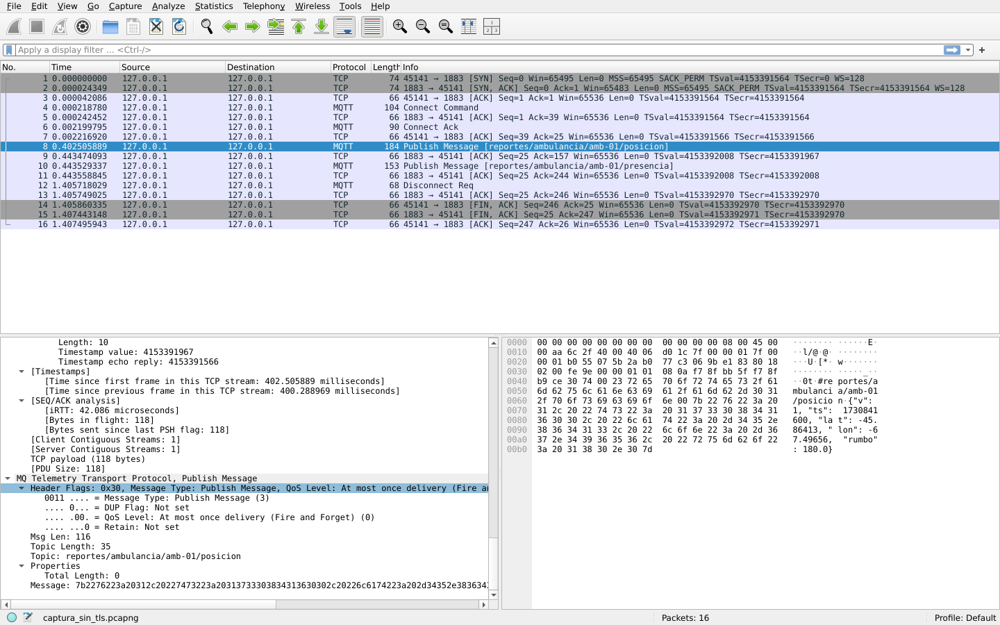
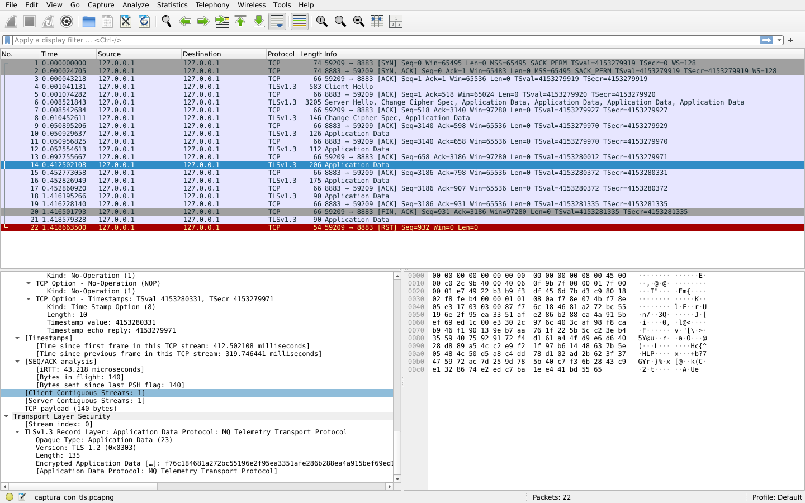

# Capturas de Tráfico Wireshark: Análisis Con TLS y Sin TLS

Documentación y evidencias correspondientes a la **Issue #20** y al **Requerimiento 5 (Seguridad / TLS)** de la consigna.

---

## 1. Resumen y Objetivo

El **Requerimiento 5** exige que:
* Las conexiones de los clientes vayan por **TLS** (puerto `8883` en EMQX) validando la autoridad certificante propia (`DistrCA` generada en `broker/certs/ca.crt`).
* No se utilicen certificados de ejemplo con claves públicas conocidas en Internet.
* Se demuestre mediante capturas de tráfico qué ve un atacante o intermediario en la red cuando **no se utiliza TLS** vs. cuando **sí se utiliza TLS**.

Para cumplir con esto, se realizaron dos capturas de paquetes reales (`.pcapng`) capturando el tráfico generado por la unidad móvil `amb-01`:

1. **`captura_sin_tls.pcapng`**: Conexión al puerto `1883` en texto plano (habilitado temporalmente en entorno de pruebas).
2. **`captura_con_tls.pcapng`**: Conexión al puerto `8883` cifrado con TLS.

---

## 2. Análisis del Tráfico SIN TLS (Puerto 1883)

Al habilitar temporalmente el listener estándar MQTT en texto plano (`1883:1883`), cualquier intermediario o sniffer en la red puede interceptar la totalidad de las comunicaciones.

### A. Exposición de Credenciales (Paquete `CONNECT`)
En el paquete 4 (`Connect Command`), los campos de autenticación viajan en texto completamente claro:

* **User Name:** `amb-01`
* **Password:** `cambiar`
* **Client ID:** `amb-01`



> **Riesgo:** Un atacante en la misma red local o mediante un ataque Man-in-the-Middle (MitM) obtiene las credenciales del sistema de forma inmediata, permitiéndole impersonar a la unidad o vulnerar otros servicios si reutiliza claves.

---

### B. Exposición de Tópicos y Payloads (Paquete `PUBLISH`)
En el paquete 8 (`Publish Message`), tanto el tópico como la carga útil (payload JSON) son visibles sin ningún cifrado:

* **Topic:** `reportes/ambulancia/amb-01/posicion`
* **Payload:** `{"v": 1, "ts": 1730841600, "lat": -45.86413, "lon": -67.49656, "rumbo": 180.0}`



> **Riesgo:** Pérdida absoluta de confidencialidad e integridad. Se exponen coordenadas geográficas en tiempo real, estado operativo de la flota y datos críticos del sistema.

---

## 3. Análisis del Tráfico CON TLS (Puerto 8883)

Al utilizar el puerto estándar seguro `8883` configurado con los certificados generados por nuestra propia CA (`ca.crt` y `server.crt` en [broker/compose.yaml](../../broker/compose.yaml)):

### A. Negociación TLS (Handshake)
Los primeros paquetes de la captura evidencian el establecimiento seguro de la sesión:
1. **TCP Handshake:** Paquetes 1 a 3 (SYN, SYN-ACK, ACK).
2. **Client Hello:** Paquete 4 (el cliente ofrece suites criptográficas modernas).
3. **Server Hello & Certificate:** Paquete 6 (el broker responde presentando su certificado emitido por `DistrCA`).
4. **Key Exchange & Finished:** Negociación de claves simétricas efímeras para cifrar el canal.

---

### B. Cifrado de Datos de Aplicación (`Application Data`)
A partir de la finalización del handshake, **todo** el tráfico MQTT viaja encapsulado dentro de registros TLS (`Application Data Protocol`):

* Wireshark no puede identificar paquetes `CONNECT`, `CONNACK`, `PUBLISH` ni `DISCONNECT`.
* No se observan nombres de usuario, contraseñas, nombres de tópicos ni coordenadas.
* El contenido se presenta como bytes opacos e ininteligibles (`Encrypted Application Data`).



> **Conclusión:** La comunicación garantiza **confidencialidad** (nadie puede leer los datos), **integridad** (ningún paquete puede alterarse sin invalidar la firma MAC) y **autenticidad** (el cliente valida la identidad del broker contra `ca.crt`).

---

## 4. Estado del Listener 1883 en Producción

Finalizada la prueba comparativa de captura, el puerto 1883 fue **desactivado**:
* En `broker/compose.yaml` se comentó el mapeo `- "1883:1883"`.
* Se estableció la variable de entorno `EMQX_LISTENERS__TCP__DEFAULT__ENABLE=false`.
* Se verificó mediante sondeo de puertos que el puerto 1883 rechaza cualquier intento de conexión (`Connection refused`), aceptando únicamente tráfico seguro en el puerto `8883`.

---

## 5. Cómo Abrir e Inspeccionar las Capturas

Los archivos `.pcapng` incluidos en este directorio pueden ser abiertos directamente con Wireshark:

```bash
# Abrir captura sin TLS
wireshark docs/capturas/captura_sin_tls.pcapng

# Abrir captura con TLS
wireshark docs/capturas/captura_con_tls.pcapng
```

Filtros útiles en Wireshark:
* `mqtt`: Muestra todos los paquetes del protocolo MQTT (solo visible en la captura sin TLS).
* `mqtt.msgtype == 1`: Filtra el paquete CONNECT para ver credenciales.
* `mqtt.topic`: Filtra publicaciones con tópicos específicos.
* `tls`: Filtra paquetes de la capa TLS en el puerto 8883.
